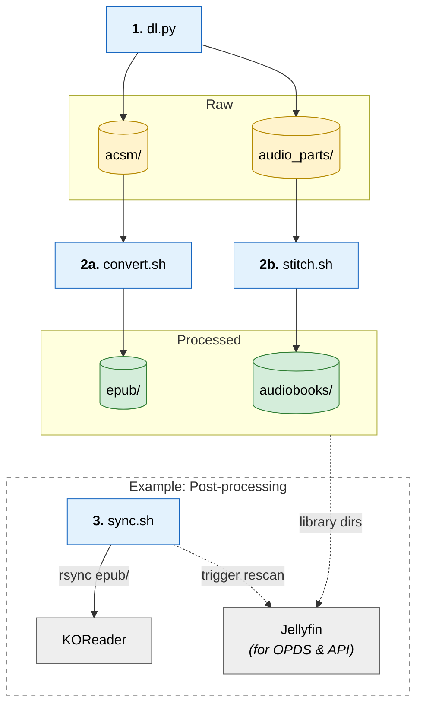

# Libby Sync

CLI scripts for Linux to download your Libby loans to disk/Jellyfin/E-Reader/etc. Supports e-books that have the option to be read as EPUB (DRM), and all audiobooks.

# Setup

```bash
uvx patchright install chromium
./dl.py login
ACSM_CONVERTER=/path/to/tool ./libby-sync
```

> Dependencies: `uv`, `ffmpeg` (if downloading audiobooks)

# libby-sync

Bash script that just runs the scripts below.



# dl.py

Downloads new ACSM files and audiobook parts from Libby. (ACSM files are valid for 6 hours.)

# convert.sh

Runs `$ACSM_CONVERTER`[^BYO] on each ACSM and puts the result in `epub/`.

[^BYO]: Bring your own.

# stitch.sh

Stitches audio parts into a single file. Outputs to `audiobooks/` 

# examples/sync.sh

My own post-processing, shown for reference[^lie]. rsyncs EPUBs to a Kindle running KOReader and triggers a Jellyfin library scan.

[^lie]: Okay I lied, it's for bragging rights.
